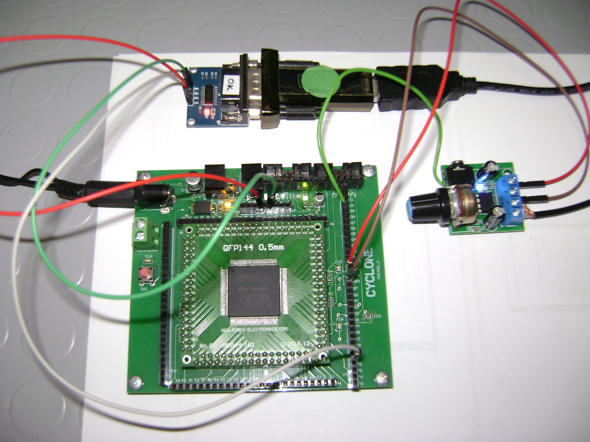

# 🎵 FPGA MP3 Player — UART, PCM & 1-Bit Audio DAC

### MP3 Audio Playback Using an Altera Cyclone FPGA

*Hardware prototype using an Altera Cyclone FPGA.*

A digital electronics project demonstrating how to reproduce MP3 audio using an **Altera Cyclone EP1C6 FPGA**, a C# application, UART communication and a simple 1-bit audio DAC.

Developed by **Vito Primoceri** for [Primok — Electronics Projects & Tutorials](https://primok.altervista.org/).

---

## 🔍 Project Overview

This project demonstrates an MP3 playback system in which a PC performs audio decoding while the FPGA handles PCM data reception and digital audio signal generation.

Instead of implementing a complex MP3 decoder inside the FPGA, the audio is decoded and converted into a simpler format by a C# application.

### System Architecture

**MP3 File**  
↓  
**C# Application** — MP3 decoding, stereo-to-mono conversion  
↓  
**8-bit Unsigned PCM — 11,025 Hz**  
↓  
**UART — 115200 baud, 8N1**  
↓  
**Altera Cyclone EP1C6 FPGA**  
↓  
**1-bit PWM Audio Output — approximately 97.656 kHz**  
↓  
**RC Low-Pass Filter — 470 Ω / 100 nF**  
↓  
**LM386 Audio Amplifier**  
↓  
**Speaker**

---

## ⚙️ Technical Specifications

| Parameter | Value |
|---|---|
| FPGA | Altera Cyclone EP1C6 |
| PC application | C# |
| Audio input | MP3 |
| PCM format | Unsigned 8-bit mono |
| Sample rate | 11,025 Hz |
| Communication | UART |
| Baud rate | 115200 (8N1) |
| Digital audio output | 1-bit PWM |
| PWM frequency | Approximately 97.656 kHz |
| Output filter | 470 Ω + 100 nF |
| Audio amplifier | LM386 |

---

## 🎯 Project Goals

- Understand the difference between MP3 compression and PCM audio.
- Transfer digital audio samples from a PC to an FPGA.
- Implement UART reception in FPGA logic.
- Generate a 1-bit digital audio signal.
- Reconstruct an analog audio signal using a low-pass filter.
- Explore FPGA-based digital audio processing.

**Important:** MP3 decoding is performed on the PC, not directly inside the FPGA.

---

## 📖 Full Tutorial & Source Code Downloads

The complete FPGA MP3 Player project is documented on **Primok**, including MP3-to-PCM conversion, UART communication, FPGA digital audio generation and hardware implementation.

🔗 **[Read the Complete FPGA MP3 Player Tutorial on Primok](https://primok.altervista.org/index.php/fpga/cyclone/riproduzione-di-file-mp3-con-fpga-conversione-in-pcm-trasmissione-uart-e-dac-digitale)**

### 📥 Available Source Code

Both software and FPGA projects have been successfully compiled and are available for download.

**💻 C# Application — Visual Studio .NET 8**

[⬇️ Download C# Source Code](https://primok.altervista.org/index.php/download-test-fpga?download=2:pcmplayer-sorgenti-c-net-8)

Includes the Windows Forms application source code, Visual Studio project files and resources.

**🔌 FPGA — VHDL & Quartus II**

[⬇️ Download VHDL Source Code & Quartus II Project](https://primok.altervista.org/index.php/download-test-fpga?download=3:pcm-player-fpga-sorgenti-vhdl-e-quartus-ii)

Includes VHDL source files, Quartus II project configuration, pin assignments and FPGA programming files.

### 🔐 Free Registration Required

Source code downloads are hosted on Primok and protected through authenticated access.

**[Register for free on Primok](https://primok.altervista.org/index.php/component/users/registration)** to access the source code and other reserved electronics projects.

---

---

## 🤝 About Primok

**Primok** is an Italian website dedicated to practical electronics, FPGA development, PIC and STM32 microcontrollers, VHDL, C programming and PCB design.

Visit the website to discover more projects and participate in the electronics community.

🌐 **https://primok.altervista.org/**

---

**⚡ Turn ideas into real electronic projects!**
